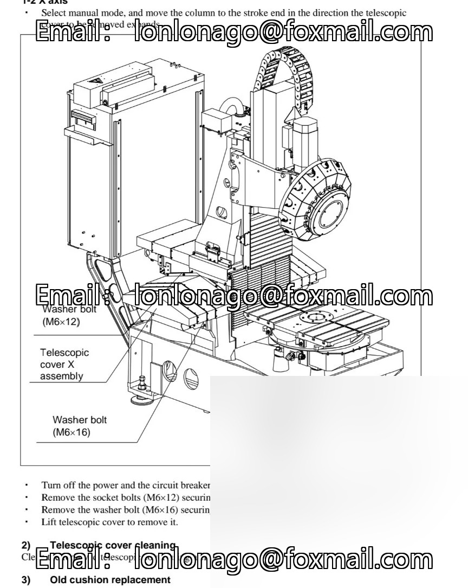
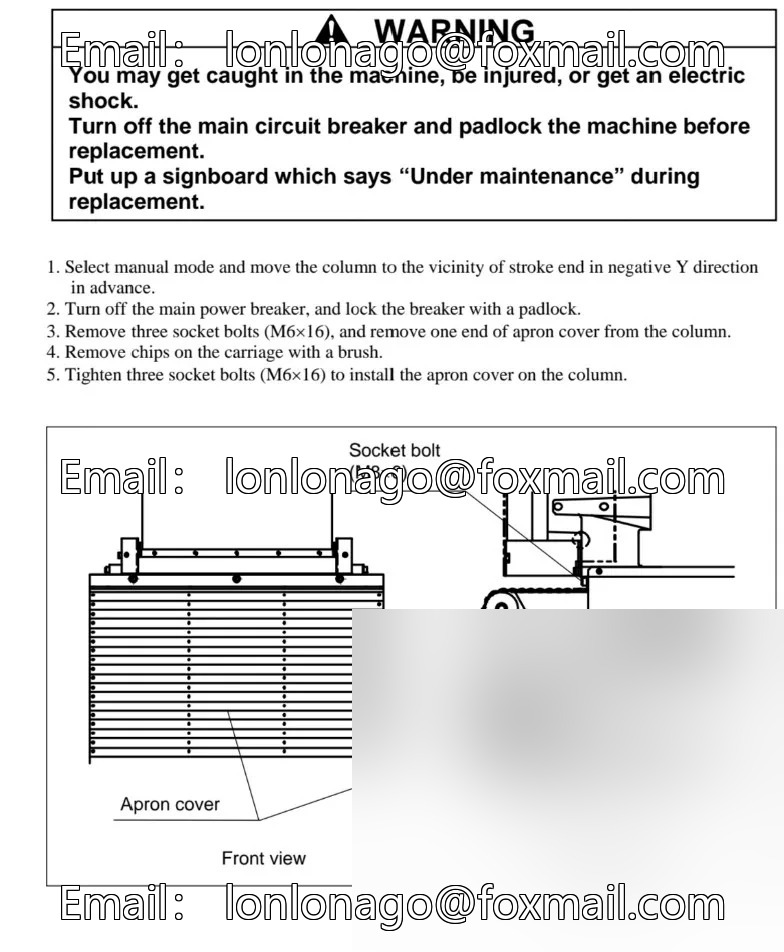
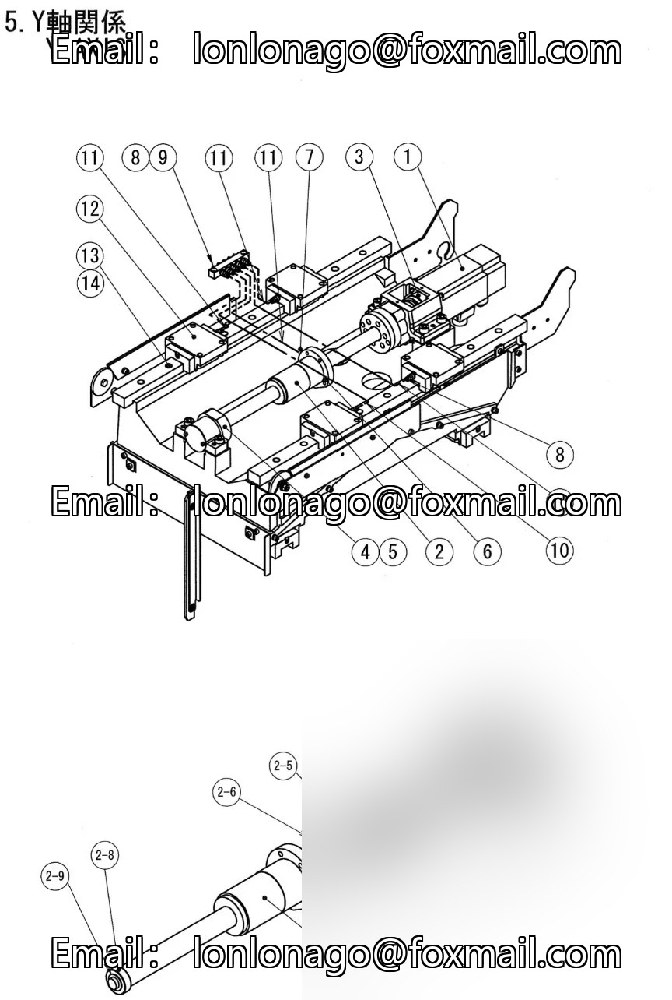
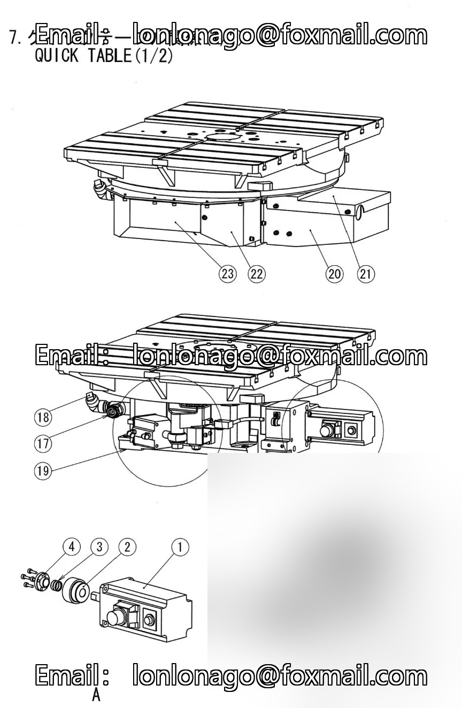
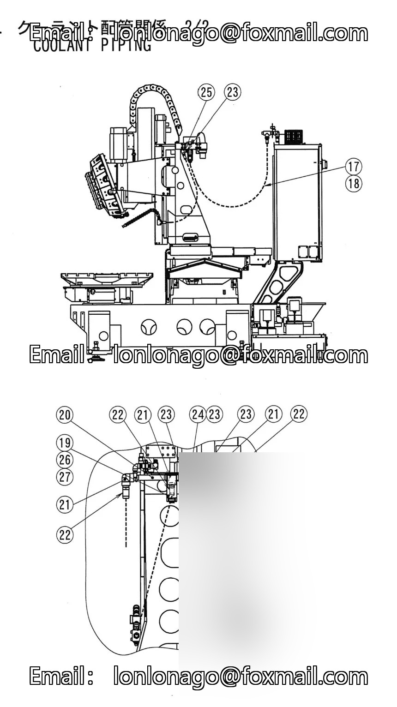
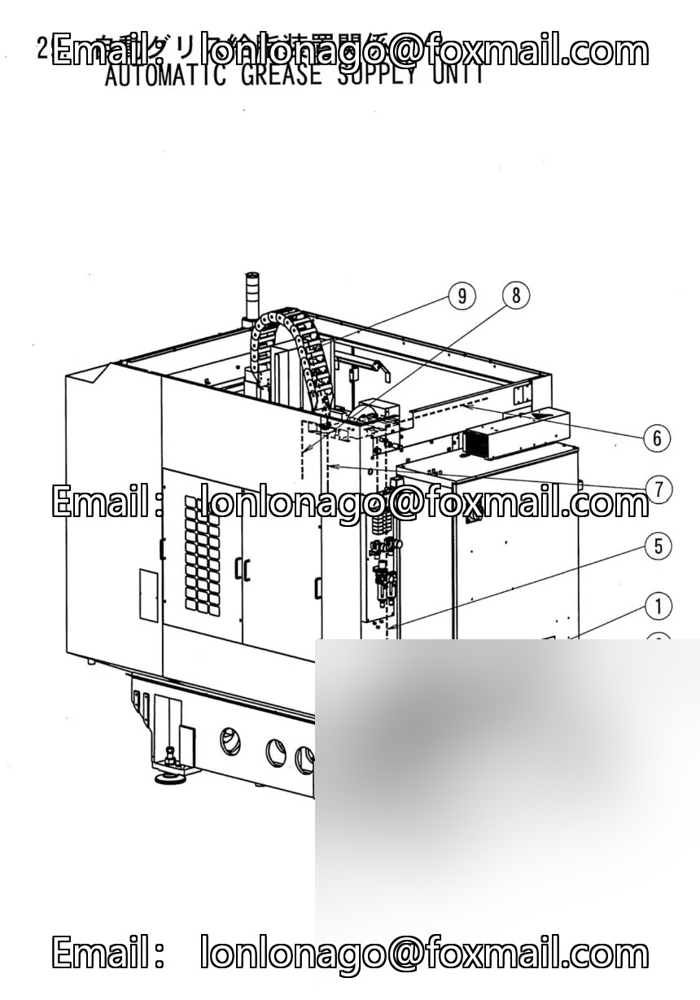

# Brother Industries

## Body

Brother Industries
Tapping Center Reference for TC-R2B Type
Electronic PDF, 650 pages
Detailed content, suitable for reference on equipment installation, maintenance, and safe operation.
The materials are in PDF format, sent directly via cloud drive link.
No pricing discussion, upon sale.

Brother Industries' manufactured TC-R2B type tapping center (Tapping Center).

This is a small numerical control machine tool mainly featuring compact design and efficient production, specially used for machining thread holes (tapping) on metal workpieces, and also possessing the capabilities of drilling and light milling. It is very popular in the manufacturing industries of electronics, automobile parts, and small precision parts.
A major feature of TC-R2B is the included tray exchange device. This means that while processing one workpiece, you can unload and load workpieces onto another tray simultaneously. Once a workpiece on a tray is fully processed, simply rotating the worktable can instantly remove the finished product and replace it with a new workpiece to be machined, thereby achieving "machining without interruption," maximizing the equipment utilization rate.
32199-TC

The material page presents Brother Industries' TC-R2B Tapping Center references with 650 pages, detailed content suited for equipment installation, maintenance and safety operation, along with visible operation and maintenance instructions.

<!-- AI_ENRICHED -->

## Images

## Payment

Here is a pay link on Stripe ( https://buy.stripe.com/3cs8yP7sY87d0vu9AB ). Please contact me lonlonago@foxmail.com after funding $89, and I will send you a complete data files , thank you!

